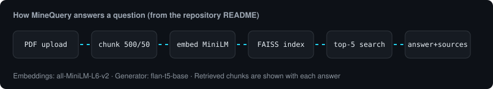

 

&nbsp;

I'm a final-year mining engineering student at NIT Raipur who builds data products: dashboards that answer business questions, models that explain themselves, and retrieval systems for technical documents. Mining and geology give me domain problems most analysts never see, and Python, SQL and Power BI are how I work on them.

**Analyze • Build • Deploy**

&nbsp;

## Selected work

Upload a mining engineering PDF, ask a question in plain language, and get an answer with the retrieved source passages beside it. Runs as a Streamlit app and as a notebook.  
[Live demo](https://minequery.lovable.app/) · [Source](https://github.com/Prakher333/rag-document-ai-assistant) · 

&nbsp;

Starts from a business question (which customers accept a campaign?), validates assumptions with t-tests and a chi-square test, then fits an XGBoost model on SMOTE-balanced data and uses SHAP to show what drives a response. Recency, past campaign acceptance and tenure came out as the main signals.  
[Source and notebook](https://github.com/Prakher333/Customer-Analytics-Marketing-Campaign-Optimization) · 

&nbsp;

A star-schema Power BI model with executive, loan, deposit and customer-segment views. The write-up covers business lending concentration, the medium-income core segment and an unexpectedly valuable loyalty tier, with recommendations for each.  
[Dashboard file, report and screenshots](https://github.com/Prakher333/banking-customer-portfolio-analysis) · 

&nbsp;

A YOLO-based mineral detector with a web front end, developed together with [Aniket Singh Rathour](https://github.com/AniketSinghRathour/Mineral-Identification). The same work became the IEEE paper below.  
[Live demo](https://mineral-identification.vercel.app) · [Source](https://github.com/Prakher333/Mineral-Identification)

&nbsp;

## Research and recognition

| | |
|---|---|
| **IEEE Xplore** | *A Deep Learning Model for Mineral Identification*, presented at CISES 2025 (3rd International Conference on Intelligent and Secure Engineering Solutions, 11–13 August 2025). Selected among 240 of 3,000+ submissions. [Read the paper](https://ieeexplore.ieee.org/document/11265485) |
| **Dev Clash 2026** | Winner. Built PrepPro, an AI-powered learning platform, with Team Invincible; 1st among 100+ teams |
| **Execute 4.0, DTU** | Finalist, top 100 teams |
| **NIT Raipur, 2024** | Best Trainee among 50 project teams in the AI & ML Innovations in Geology and Water Resources program |

&nbsp;

## Toolkit

|  |  |
|---|---|
| **Analytics and BI** | Power BI, DAX, Power Query, Excel, SQL (100+ practice problems: joins, subqueries, window functions), EDA, hypothesis testing |
| **Python** | Pandas, NumPy, Matplotlib, Seaborn, scikit-learn, XGBoost, SHAP |
| **ML and GenAI** | RAG, FAISS, SentenceTransformers, LangChain, Hugging Face models, YOLO-based detection |
| **Apps and tools** | Streamlit, Jupyter, VS Code, Git |

&nbsp;

## Background

| | |
|---|---|
| **Education** | B.Tech, Mining Engineering, NIT Raipur · 2027 · CGPA 7.94 |
| **Industrial training** | MOIL Limited, Balaghat · May–June 2026 · underground manganese mining: ventilation, surveying, drilling and blasting, safety |
| **Leadership** | Overall Coordinator, Think India, NIT Raipur (since Nov 2025) · Executive, PR domain, Entrepreneurship Cell (2024–25) |
| **Certificates** | AI Fluency: Framework Foundations, Anthropic Academy (2026) · AI Fluency for Small Businesses, PayPal and Anthropic Academy (2026) |

&nbsp;

Raipur, India · [LinkedIn](https://www.linkedin.com/in/prakher-dwivedi-a51995318/) · [prakherdwivedi21@gmail.com](mailto:prakherdwivedi21@gmail.com)

